<h3>Hi there :wave:</h3>

My name is Stas.

- [DDEV](https://github.com/ddev/ddev) Maintainer (Golang Developer) since Autumn 2023
- Join me in the 
- PHP Developer since 2018
- Experienced in the entire project development life cycle, including coding, software testing, and debugging

  
:zap: Recent GitHub Activity

<!--RECENT_ACTIVITY:start-->
1. 💬 Commented on [#9032](https://github.com/ddev/ddev/pull/9032#discussion_r4427470110) in [ddev/ddev](https://github.com/ddev/ddev) 
2. 💬 Commented on [#9032](https://github.com/ddev/ddev/pull/9032#discussion_r4427469926) in [ddev/ddev](https://github.com/ddev/ddev) 
3. 💪 Opened PR [#12](undefined) in [ddev/agent-skills](https://github.com/ddev/agent-skills) 
4. 💪 Opened PR [#11](undefined) in [ddev/agent-skills](https://github.com/ddev/agent-skills) 
5. 👍 Approved [#9026](https://github.com/ddev/ddev/pull/9026#pullrequestreview-5717542148) in [ddev/ddev](https://github.com/ddev/ddev) 
6. 🔴 Requested changes in [#9032](https://github.com/ddev/ddev/pull/9032#pullrequestreview-5717240119) in [ddev/ddev](https://github.com/ddev/ddev) 
7. 💬 Commented on [#9032](https://github.com/ddev/ddev/pull/9032#issuecomment-6530694890) in [ddev/ddev](https://github.com/ddev/ddev) 
8. 💬 Commented on [#9026](https://github.com/ddev/ddev/pull/9026#discussion_r4414109386) in [ddev/ddev](https://github.com/ddev/ddev) 
9. 💬 Commented on [#9026](https://github.com/ddev/ddev/pull/9026#discussion_r4414109408) in [ddev/ddev](https://github.com/ddev/ddev) 
10. 💪 Opened PR [#10](undefined) in [ddev/agent-skills](https://github.com/ddev/agent-skills) 
11. 💪 Opened PR [#9](undefined) in [ddev/agent-skills](https://github.com/ddev/agent-skills) 
12. 💪 Opened PR [#8](undefined) in [ddev/agent-skills](https://github.com/ddev/agent-skills) 
13. 💪 Opened PR [#7](undefined) in [ddev/agent-skills](https://github.com/ddev/agent-skills) 
14. 💪 Opened PR [#6](undefined) in [ddev/agent-skills](https://github.com/ddev/agent-skills) 
15. 💬 Commented on [#24](https://github.com/coder-ddev-com/access-requests/issues/24#issuecomment-6497171334) in [coder-ddev-com/access-requests](https://github.com/coder-ddev-com/access-requests) 
16. ✔️ Closed issue [#24](https://github.com/coder-ddev-com/access-requests/issues/24) in [coder-ddev-com/access-requests](https://github.com/coder-ddev-com/access-requests) 
<!--RECENT_ACTIVITY:end-->

  
:zap: GitHub Stats

  <picture>
    <source
      srcset="./profile/stats-dark.svg"
      media="(prefers-color-scheme: dark)"
    />
    <source
      srcset="./profile/stats-light.svg"
      media="(prefers-color-scheme: light), (prefers-color-scheme: no-preference)"
    />
    
  </picture>

